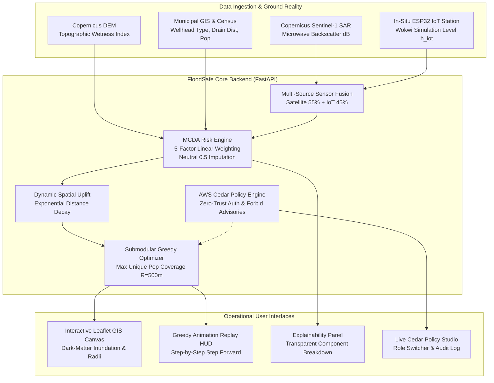

# FloodSafe — Comprehensive Technical Explanation & System Architecture
**Post-Flood Water Vulnerability Triage, In-Situ IoT Ground Reality & Maximum-Coverage Allocation Engine**

---

## 1. Executive Summary & Problem Statement

### 1.1 The Post-Disaster Decision Crisis
Following catastrophic flood events (e.g. monsoons, river overtopping, urban flash ponding), municipal drinking-water infrastructure—such as tube wells, public boreholes, gravity-fed taps, and community storage sumps—faces immediate vulnerability to bacterial, viral, and chemical contamination from sewer backflow and agricultural run-off.

Disaster response agencies and municipal health departments face a severe **resource-capacity bottleneck**:
* **Constrained Capacity ($K$)**: Response teams possess a strictly limited testing budget (e.g., $K = 15$ or $20$ rapid-testing kits, limited laboratory batch capacity, and few field personnel).
* **Massive Asset Inventory**: Hundreds of decentralized water points (often $500+$ sites across an urban basin) require evaluation.
* **Information Asymmetry**: Satellite radar passes can take days to revisit, cloud cover blocks optical cameras, and GIS records often contain missing historical or drainage distances.

### 1.2 The Naive Triage Trap
When authorities attempt to prioritize without mathematical decision support, they typically fall into one of two traps:
1. **Unsystematic/Ad-Hoc Testing**: Field teams travel arbitrarily, leaving dense low-income communities untested.
2. **Naive Top-$K$ Sorting**: Ordering sources strictly by risk score and testing the top $K$ results in **severe spatial clustering**. Multiple test kits are dispatched to adjacent wells located $50\text{m}$ apart, redundantly testing the exact same flooded aquifer and wasting scarce kits, while leaving other vulnerable wards unprotected.

### 1.3 FloodSafe's Mission & Boundary Guardrails
FloodSafe acts as a decision-support layer between macro remote sensing, physical ground telemetry, and field verification. 

> **Core Statutory Boundary (Non-Negotiable):**
> FloodSafe calculates **relative vulnerability priority for testing kit deployment**. It **never** claims proven medical contamination, never produces automated diagnostic claims, and never replaces certified laboratory microbiology.

---

## 2. End-to-End System Architecture

FloodSafe operates as a cyber-physical system integrating satellite remote sensing, embedded IoT hydrometric stations, multi-criteria risk scoring, submodular optimization, and AWS Cedar zero-trust authorization.



---

## 3. Deep-Dive: Core Modules & Mathematical Logic

### 3.1 Multi-Source Sensor Fusion: Satellite SAR + In-Situ IoT
To determine whether an area is flooded, FloodSafe solves the fundamental trade-off between **macro basin coverage** and **micro real-time ground truth**:

1. **Macro Observation (Sentinel-1 SAR Radar)**:
   * Uses $C$-band Synthetic Aperture Radar (VV polarization).
   * Standing open water acts as a specular reflector, bouncing radar pulses away from the sensor and yielding very low sigma-nought backscatter ($\sigma^0 \le -16.5\text{ dB}$).
   * Sigmoidal water probability model:
     $$P_{\text{SAR}} = \frac{1}{1 + e^{0.85 \cdot (\sigma^0 - (-16.5))}}$$

2. **Micro Ground Truth (ESP32 In-Situ IoT Hydrometric Node)**:
   * Ultrasonic transducers measure physical water surface elevation in municipal culverts.
   * Normalized water depth against the $0.80\text{m}$ overtopping danger mark:
     $$\text{IoT}_{\text{norm}} = \min\left(\frac{h_{\text{water}}}{0.80\text{ m}}, 1.0\right)$$

3. **Fused Exposure Equation**:
   When both satellite radar and local IoT ground telemetry are available:
   $$\text{flood\_exposure}_{\text{fused}} = 0.55 \cdot P_{\text{SAR}} + 0.45 \cdot \text{IoT}_{\text{norm}}$$
   * If the IoT node is offline or missing, FloodSafe falls back to $P_{\text{SAR}}$ and flags a data quality penalty, strictly upholding the **No Silent Zeroes** invariant.

---

### 3.2 The Explainable MCDA Risk Engine

FloodSafe calculates the **relative vulnerability score** $S \in [0.0, 1.0]$ using a transparent, multi-criteria demonstration model:

$$S = \sum_{i=1}^{5} w_i \cdot x_i + \text{Uplift}_{\text{spatial}}$$

$$\text{Weights: } w_{\text{flood}} = 0.30, \quad w_{\text{drain}} = 0.25, \quad w_{\text{hist}} = 0.15, \quad w_{\text{vuln}} = 0.15, \quad w_{\text{pop}} = 0.15$$

| Feature ($x_i$) | Raw Input | Normalization Formula | Physical Direction |
| :--- | :--- | :--- | :--- |
| **`flood_exposure`** | Radar dB + IoT level ($m$) | Fused $0.0 - 1.0$ indicator | Higher $\rightarrow$ Greater inundation exposure |
| **`drain_proximity_risk`** | Distance to open drain ($m$) | $1.0 - \min\left(\frac{d_{\text{drain}}}{1000.0\text{m}}, 1.0\right)$ | Closer to drain $\rightarrow$ Higher overflow risk |
| **`historical_risk`** | Previous flood contamination | Normalized event frequency ($0.0 - 1.0$) | Documented incidents $\rightarrow$ Higher score |
| **`source_vulnerability`** | Wellhead type & casing | Rule-based (Well: $0.70$, Tap: $0.40$, Sump: $0.50$) | Unprotected wellhead $\rightarrow$ Higher risk |
| **`population_exposure`** | Registered user count | $\min\left(\frac{\text{Pop}_{\text{served}}}{5000}, 1.0\right)$ | More residents $\rightarrow$ Higher consequence |

#### Strict Non-Negotiable: The "No Silent Zeroes" Standard
In emergency triage, replacing a missing sensor record with `0.0` introduces **deadly bias**—it makes a dangerously flooded well appear safe just because a telemetry reading was lost.
* Whenever a feature is missing ($x_i = \text{null}$), FloodSafe imputes a **documented neutral prior ($0.50$)**.
* An explicit **Quality Confidence Penalty** is deducted:
  $$\text{Quality Score} = 1.0 - \frac{\text{Number of Missing Features}}{5}$$
* Both the score breakdown drawer and API payloads prominently display the missing inputs and confidence percentage.

---

### 3.3 Dynamic Spatial Uplift Propagation (Hydrological Feedback)

When a field team conducts a rapid physical test and records an **abnormal result** (e.g. turbidity surge or bacterial indicator), FloodSafe does not treat that well in isolation. Contamination spreads through hydrological aquifers and open drainage gradients.

FloodSafe propagates dynamic spatial uplift to all unverified neighbor sources within $d \le 300\text{m}$:
$$\Delta S(s) = \sum_{t \in \text{AbnormalTests}} \alpha \cdot \exp\left(-\frac{\text{distance}(s, t)}{\sigma}\right) \cdot \gamma_{\text{drainage}}$$

Where:
* Base uplift parameter $\alpha = 0.10$.
* Exponential spatial decay constant $\sigma = 400.0\text{m}$.
* Directional drainage modifier $\gamma$:
  * **$1.35\times$** if source $s$ is downstream along the drainage gradient.
  * **$0.85\times$** if source $s$ is upstream.

Every affected source highlights the dynamic uplift in red with full attribution (origin well code and distance in meters).

---

### 3.4 Submodular Greedy Maximum-Coverage Optimizer

#### The Mathematical Problem Formulation
Given a budget of $K$ physical testing kits and candidate water sources $S = \{s_1, s_2, \dots, s_N\}$, select a subset $S^* \subseteq S$ with $|S^*| \le K$ to maximize the **unique high-risk population covered** within effective walking/service radius $R = 500\text{m}$:

$$\max_{S^* \subseteq S, \, |S^*| \le K} f(S^*) \quad \text{where} \quad f(S^*) = \sum_{u \in \bigcup_{s \in S^*} \text{CoveredUnits}(s, R)} \text{Population}(u) \cdot \mathbb{I}(\text{is\_high\_risk}(u))$$

#### Why Submodularity Guarantees Near-Optimal Performance
The objective function $f(S^*)$ exhibits **diminishing marginal returns** (submodularity): adding a site covers fewer *new* people if nearby sites have already been selected.

By Nemhauser's Theorem (1978), the **Greedy Maximum-Coverage Algorithm** guarantees a provable approximation ratio of:
$$f(S_{\text{greedy}}) \ge \left(1 - \frac{1}{e}\right) \cdot f(S_{\text{optimal}}) \approx 63.2\% \cdot f(S_{\text{optimal}})$$

#### Greedy Iteration Step:
At step $k \in \{1, \dots, K\}$, choose the candidate source $s^*$ that maximizes the **marginal unique population gain**:
$$s^* = \arg\max_{s \in S \setminus S_{k-1}} \left[ f(S_{k-1} \cup \{s\}) - f(S_{k-1}) \right]$$
Tie-breaking gives preference to higher relative vulnerability score $S$.

#### Empirical Benchmark Results ($N=500$ Sources, $K=15$, $R=500\text{m}$):
```
-----------------------------------------------------------------------------------------
Allocation Strategy                  Unique Pop Covered    Pop / Kit    Lift Over Baseline
-----------------------------------------------------------------------------------------
FloodSafe Greedy Max-Coverage             218,383           14,558.9    SELECTED OPTIMAL
Top-K Naive Risk Sorting                   78,609            5,240.6    +177.8% Greedy Lift
Random Baseline (1,000 Trials)             73,174.8          4,878.3    +198.4% Greedy Lift
-----------------------------------------------------------------------------------------
```

---

## 4. Cyber-Physical IoT Hardware Simulation (Wokwi + ESP32)

To demonstrate true hardware-software integration, FloodSafe includes an interactive microcontroller simulation accessible at **[wokwi.com/projects/477569569661872129](https://wokwi.com/projects/477569569661872129)**.

```
+-----------------------------------------------------------------------+
|                         ESP32 DevKit-C v4                             |
|                                                                       |
|  [GPIO 5]  --- Trig ---> [HC-SR04 Ultrasonic Depth Sensor]           |
|  [GPIO 18] <-- Echo ---                                               |
|                                                                       |
|  [GPIO 21] --- SDA ----> [SSD1306 128x64 I2C OLED Display]           |
|  [GPIO 22] --- SCL ----> (Live Depth Gauge + Threshold HUD)           |
|                                                                       |
|  [GPIO 2]  -----------> [GREEN LED]  -> NORMAL (<0.35m)               |
|  [GPIO 4]  -----------> [AMBER LED]  -> ALERT  (0.35m - 0.79m)        |
|  [GPIO 15] -----------> [RED LED]    -> FLOODED (>=0.80m)             |
|  [GPIO 13] -----------> [PIEZO BUZZER] (Acoustic Overtopping Alarm)   |
+-----------------------------------------------------------------------+
```

### Firmware Operating Logic (`hardware/wokwi/sketch.ino`):
1. **Speed-of-Sound Echo Timing**: Captures pulse return time and translates to depth:
   $$\text{Water Level (m)} = \frac{200.0\text{cm} - (\text{pulseIn}(\mu\text{s}) \cdot 0.0343 / 2)}{100.0}$$
2. **Threshold Actuation**:
   * $<0.35\text{m}$: Green LED, display shows `NORMAL`.
   * $0.35\text{m} - 0.79\text{m}$: Amber LED, display shows `ALERT`.
   * $\ge 0.80\text{m}$: Red LED, active buzzer alarm pulses at $1000\text{Hz}$, display flashes `*** FLOOD OVERTOPPING ***`.
3. **Telemetry Streaming**: Emits JSON payloads via HTTP `PATCH` to `/api/v1/iot-sensors/{node_id}/telemetry` to update the GIS map and recalculate triage scores.

---

## 5. AWS Cedar Policy Security Architecture

FloodSafe implements zero-trust role-based access control and strict boundary enforcement using AWS’s open-source **Cedar Policy Engine** (`policies/floodsafe.cedar`):

### 5.1 The Four Roles
1. **`Admin`**: Municipal Health Commissioner. Can tune mathematical weights, create plans, record verified tests, and inspect audits.
2. **`TriageLead`**: Emergency Operations Center Lead. Can optimize plans and trigger assessments.
3. **`FieldOperator`**: Dispatch testing personnel. Can record simulated rapid tests in the field.
4. **`Viewer`**: Public / Agency observer. Read-only cartographic access.

### 5.2 Mandatory Safety Invariant: Forbid Public Advisories
```cedar
// Invariant: Unconditionally forbid issuing automated contamination advisories
// across ALL roles to prevent automated public panics.
forbid (
    principal,
    action == FloodSafe::Action::"IssueAdvisory",
    resource
);
```

### 5.3 Default-Deny Architecture
Unless an explicit Cedar permit rule matches the user’s role, action, and target resource, access is rejected with a `403 FORBIDDEN`.

---

## 6. Frontend GIS Dashboard Architecture

The frontend is built with React 18, TypeScript, and React-Leaflet:

* **Dark-Matter Cartographic Canvas (`RiskMap.tsx`)**:
  * Visualizes flood inundation polygons with custom SVG shaders.
  * 500 candidate water sources color-coded by risk band (Danger Crimson, Warning Amber, Ochre, Pine Green).
  * 12 pulsating in-situ IoT ground station markers with real-time level meters.
  * Dispatched $500\text{m}$ metric coverage circles with geodesic geometry.
* **Greedy Step-by-Step Replay HUD**:
  * Play, Pause, and Step buttons let users replay the exact sequence chosen by the Greedy Optimizer.
  * Real-time HUD displays marginal population added at each step, verifying that no population is ever double-counted.
* **Explainability Drawer ("WHY?" Panel)**:
  * Breaks down the mathematical contributions for any selected well.
  * Visualizes DEM Elevation, TWI, Sentinel-1 SAR Radar dB, and live in-situ IoT depth telemetry side by side.
* **Live Cedar Studio**:
  * Real-time role switcher testing Cedar policy evaluations on the fly.

---

## 7. Verification & Code Quality Metrics

| Verification Suite | Result | Command |
| :--- | :--- | :--- |
| **Pytest Backend Tests** | **44 / 44 Passed (100%)** | `python -m pytest` |
| **Specification Drift Checks** | **10 / 10 Passed (100%)** | `python scripts/drift_check.py` |
| **Empirical Optimizer Lift** | **+177.8% vs. Top-K, +198.4% vs. Random** | `python scripts/evaluate_optimizer.py` |
| **Frontend Production Build** | **0 Errors, 0 Lint Warnings** | `npm run build` |

---

## 8. Pitch & Presentation Guide (3-Minute Script)

### Minute 1: The Problem & The Decision Gap (0:00 – 1:00)
> *"Following severe floods, drinking-water sources are vulnerable to runoff contamination. But emergency teams have limited test kits. Sorting by risk score causes all kits to cluster around the same flooded puddle. FloodSafe solves this by combining multi-source evidence—satellite radar, elevation models, and ground IoT—to optimize test kit deployment so the maximum number of unique vulnerable people are covered."*

### Minute 2: Explainable AI & In-Situ IoT Ground Reality (1:00 – 2:00)
> *"Satellites pass only every few days and cannot see beneath building canopies. That's why we built an in-situ IoT depth station on ESP32, simulated live in Wokwi. When water overtops 0.80m, the physical node alarms and streams telemetry into our backend. Our risk engine combines this with Sentinel-1 SAR radar. Every score is fully explainable—clicking any well breaks down the exact mathematical formula with documented neutral imputation for missing data."*

### Minute 3: Greedy Optimizer & AWS Cedar Safety (2:00 – 3:00)
> *"With our budget of 15 kits, naive ranking covers only 78,000 residents because of overlapping coverage circles. FloodSafe’s submodular Greedy Optimizer covers 218,000 residents—a +177.8% efficiency gain with zero double-counting. Finally, security is enforced with AWS Cedar: strict default-deny, and a hard safety invariant that forbids automated contamination advisories across all roles to prevent public panic."*

---

## 9. Anticipated Judge Q&A Cheatsheet

**Q1: How do you prevent your system from falsely diagnosing clean water as contaminated?**
> *"FloodSafe calculates relative vulnerability priority for triage, never medical or biological contamination. We explicitly display statutory disclaimers on every API response and UI view."*

**Q2: What happens if an IoT sensor in a ward gets knocked offline by floodwaters?**
> *"We follow a strict 'No Silent Zeroes' rule. Instead of assuming zero risk, our engine imputes a neutral prior of 0.50, applies a visible quality confidence penalty, and cites the offline status directly in the explanation narrative."*

**Q3: Why did you use Greedy Maximum Coverage instead of an integer programming solver like Gurobi?**
> *"Submodular maximum coverage runs in $O(K \cdot N)$ time, making it instantaneous in the browser and field environments, while mathematically guaranteeing at least 63.2% of the theoretical global optimum via the $(1 - 1/e)$ bound."*

**Q4: How does AWS Cedar add value over standard FastAPI JWT middleware?**
> *"Cedar decouples security policies from application logic. Policies like forbidding automated public advisories or restricting verified lab overrides are expressed declaratively, auditable by compliance officers, and evaluated locally with zero latency using Rust-backed cedarpy bindings."*
